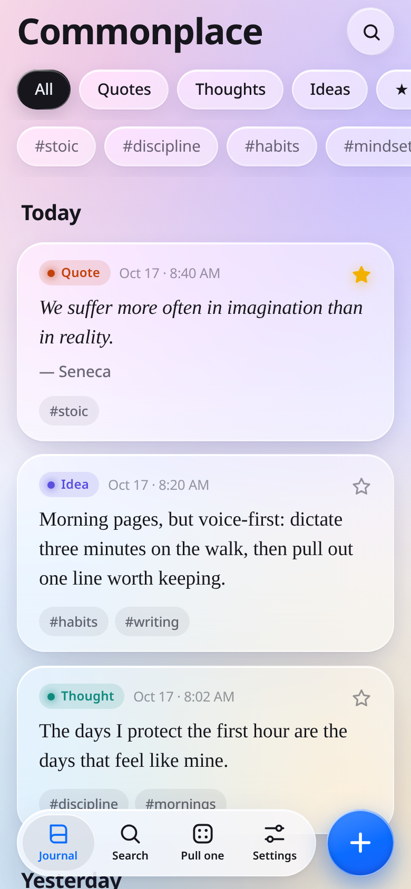
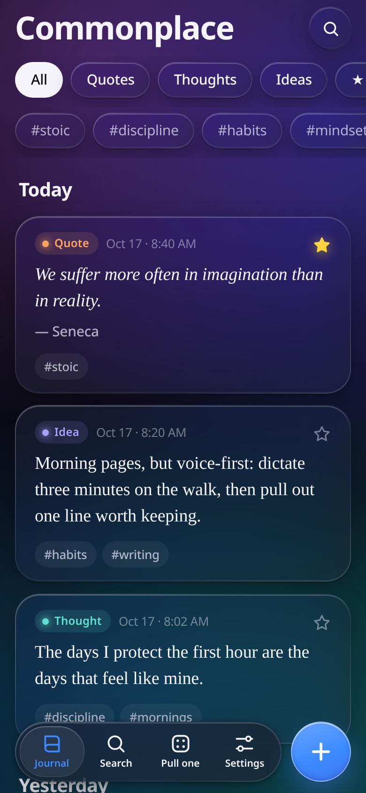
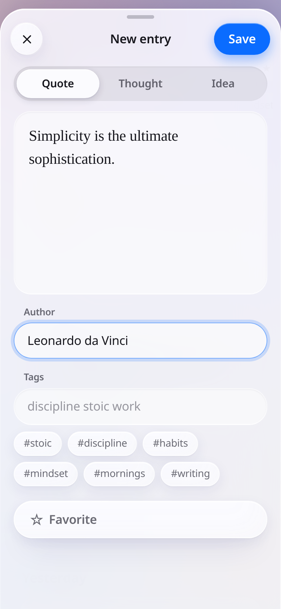
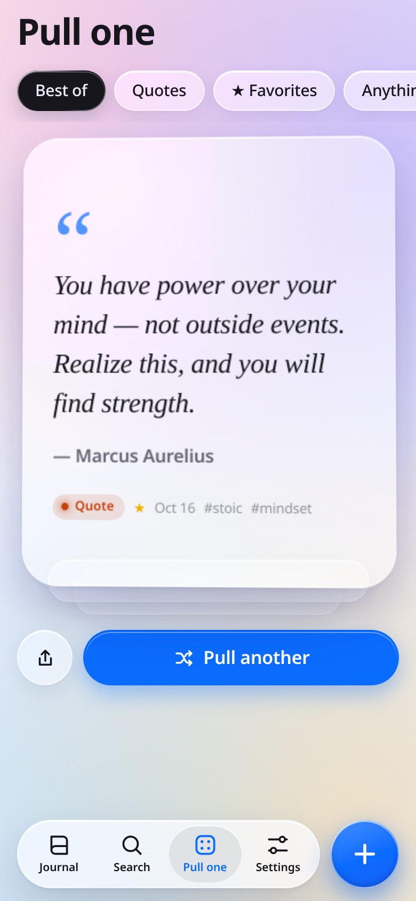

# Commonplace

A minimalist commonplace journal for capturing quotes, thoughts, and ideas. Built as a static PWA with a Liquid Glass design, your data stays on-device in localStorage — no backend, no account required.

**Live:** [commonplace-gray-psi.vercel.app](https://commonplace-gray-psi.vercel.app)

## Screenshots

<p align="center">
  
  
  
  
</p>

## Features

- **Quick capture** — Add quotes (with author), thoughts, or ideas (with source) in one tap
- **Tags** — Organize entries with custom tags
- **Favorites** — Star important entries for quick access
- **Search** — Find entries by text, author, or tags
- **Pull One** — Surface a random entry for reflection
- **Export/Import** — Full JSON backup and restore
- **Offline PWA** — Works without internet once installed
- **Liquid Glass UI** — Modern translucent design with dark mode support
- **Privacy-first** — All data stored in on-device localStorage, no backend

## Run Locally

Serve the directory with any static file server:

```bash
npx serve .
```

Or use Python:

```bash
python3 -m http.server 8000
```

Then open [http://localhost:8000](http://localhost:8000) (or the port shown).

## Deploy

This is a static site with no build step. Deploy to Vercel:

1. Push to a GitHub repo
2. Import the repo in [Vercel](https://vercel.com/new)
3. Deploy — Vercel auto-detects the static config from `vercel.json`

## Add to iPhone Home Screen

1. Open the app in Safari
2. Tap the Share button (square with arrow)
3. Scroll down and tap **Add to Home Screen**
4. Name it and tap **Add**

The app will launch in standalone mode with its own icon, working fully offline.

## Native App

See [PORTING.md](PORTING.md) for the JSON export schema and Swift models to build a native SwiftUI companion app.
